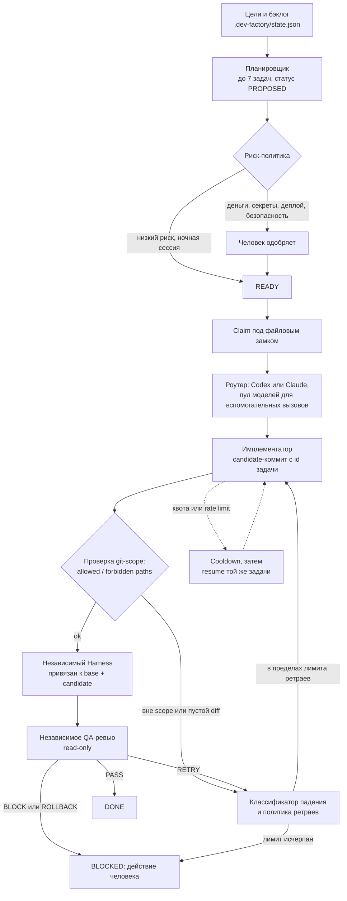

# Developer Factory — кейс-витрина

> **English summary.** Developer Factory is a local, state-file-driven system that coordinates AI coding agents
> (Claude Code and Codex CLIs): it keeps a structured backlog, plans small scoped tasks, claims them under a file lock,
> runs an agent to produce a candidate commit, then verifies it with an *independent* test harness and an *independent*
> read-only QA review before a task can become `done`. This repository is a documentation-only showcase; the source
> is private (it lives in the GiftQuest monorepo under `tools/dev-factory`). **Honest status as of the 2026-10-11 audit:**
> the sequential autopilot, model pool, quality gate, runtime-health and dashboard exist in the main branch;
> the **parallel DAG orchestrator exists only in an unmerged branch** and **chaos/long-run phase 8.7 has neither code nor
> tests** — both are roadmap, not shipped.

Источник фактов: `STATUS_REPORT.md` (аудит 2026-10-11, read-only), `docs/DEVELOPER_FACTORY.md`,
`docs/factory-v2/*.md`, `tools/dev-factory/src`, `AGENTS.md`. Цифры и ссылки — в [docs/EVIDENCE.md](docs/EVIDENCE.md),
список неподтверждённого — [docs/NOT_CONFIRMED.md](docs/NOT_CONFIRMED.md).

---

## 1. Проблема и для кого

**Проблема.** Когда код пишут ИИ-агенты, нужны не «ещё один промпт», а протокол: кто какую задачу взял, в каких путях
вправе менять файлы, чем подтверждена готовность и что делать при лимитах/сбоях. Без этого два агента
пересекаются, агент сам объявляет задачу готовой, а ночной прогон ломает рабочее дерево.

**Для кого.** Для одного владельца-продакта, который управляет несколькими ИИ-агентами (Claude, Codex) на реальном
продукте (GiftQuest) и хочет принимать результат по независимым проверкам, а не по словам агента.
(`docs/DEVELOPER_FACTORY.md`: «small local protocol for sequential Claude and Codex work».)

## 2. Как устроено

TypeScript-пакет `tools/dev-factory` (Zod, Node child processes), состояние в `.dev-factory/state.json` под файловым
замком с атомарной записью; вызывается npm-скриптами `factory:*`. Это не сервер; демон — только отдельный read-only
дашборд `apps/factory-dashboard` (`docs/factory-v2/FACTORY_V2_ARCHITECTURE.md` §1).

### 2.1 Роли агентов

| Роль | Что делает | Модуль (в `tools/dev-factory/src`) | Статус в `test-launch` |
|---|---|---|---|
| Планировщик | Анализирует цели, handoff'ы, docs, TODO, аудит; предлагает до 7 задач с критериями приёмки, путями и зависимостями. Всегда `PROPOSED` | `planner.ts`, `recommendations.ts` | есть |
| Автоодобрение (риск-политика) | Низкорисковые задачи может одобрить без человека: ≤5 путей, нет денег/секретов/деплоя; лимиты 3 за цикл, 8 за сессию | `risk-policy.ts`, `auto-approve.ts` | есть |
| Роутер / пул моделей | Выбор агента (Codex-first, Claude для short architecture/research) и пул внешних LLM-провайдеров с health/fallback | `agent-routing.ts`, `router-signals.ts`, `model-pool*.ts` | есть |
| Имплементатор | Запускает `claude -p` / `codex exec`, должен вернуть атомарный candidate-коммит с id задачи | `autopilot.ts`, `agent-cli.ts`, `prompt.ts`, `worktree.ts` | есть |
| QA | Независимый Harness (проверки привязаны к base+candidate коммитам) и независимое QA-ревью в read-only режиме | `quality-gate.ts`, `security-policy.ts` | есть |
| Ремонт | Классификатор причин падения и политика ретраев | `failure-classifier.ts`, `retry-policy.ts` | частично: подзадачи ремонта (`repair-subtask.ts`, `integration-repair.ts`) только в несмерженной ветке |
| Надёжность рантайма | Heartbeat, PID-lock, восстановление после рестарта, cooldown по квотам | `runtime-health.ts`, `durable-worker.ts`, `quota.ts`, `atomic-file.ts` | есть |
| Оркестратор DAG | Параллельные воркеры в git-worktree, очередь интеграции | `orch-*.ts`, `integration-*.ts` | **нет в `test-launch`** (только ветка) |

### 2.2 Поток задачи: от бэклога до проверки

Основа — `docs/DEVELOPER_FACTORY.md` (разделы «Commit-bound work and independent QA», «Autopilot», «Planner V1»,
«Policy Auto-Approve», «Night Run Reliability»).

### 2.3 Связь с модулями-демо

Четыре отдельных демо-репозитория модулей (имена относительные, каталог портфолио;
на момент подготовки витрины в нём этих репозиториев ещё нет):

| Репозиторий | Что это | Откуда в системе |
|---|---|---|
| `model-pool` | Мульти-провайдерный пул LLM: health, fallback, квоты | `model-pool*.ts`, `provider-models.json` |
| `quality-gate` | Independent Harness + QA + политики безопасности/риска | `quality-gate.ts`, `security-policy.ts`, `risk-policy.ts` |
| `agent-runtime` | Runtime health, durable worker, атомарные файлы, квоты | `runtime-health.ts`, `durable-worker.ts`, `atomic-file.ts`, `quota.ts` |
| `lead-hunter` | **Относится к продажам, не к самой фабрике.** Read-only поиск рекламодателей GiftQuest в Telegram; использует пул моделей фабрики | `tools/tg-harness/src/lead-hunter` |

## 3. Ключевые решения и почему

| Решение | Почему (по документам) | Источник |
|---|---|---|
| Агент не может сам принять задачу: completion только через Harness + QA, привязанные к candidate-коммиту | Исключить самоаттестацию; PASS отвергается при упавшем Harness или отчёте от другого коммита | `docs/DEVELOPER_FACTORY.md` |
| Продолжение сессии (`--resume`) подключено только к попыткам имплементатора; в QA/Harness-путях такой директивы нет по построению | Независимость проверки | `docs/DEVELOPER_FACTORY.md` (Same-task session continuation) |
| Состояние — один JSON под замком, атомарная запись; второго источника правды нет | Простота и аудируемость | `docs/DEVELOPER_FACTORY.md`, `FACTORY_V2_ARCHITECTURE.md` |
| Планировщик создаёт только `PROPOSED`; человек или низкорисковая политика переводят в `READY` | Контроль над тем, что запускается без присмотра | `docs/DEVELOPER_FACTORY.md` |
| Деньги, секреты, деплой, push, security — никогда не автоодобряются; fail-closed политика безопасности | Автономность ограничена риском | `docs/DEVELOPER_FACTORY.md` (Policy Auto-Approve V1, Security foundation Phase 0) |
| Внешний текст (GitHub issues, веб, скачанные skills/MCP) — `UNTRUSTED_EXTERNAL`, не получает полномочий | Защита от prompt injection | `docs/DEVELOPER_FACTORY.md` (Security foundation) |
| Квота/лимит не считается ретраем: cooldown (по умолчанию 15 мин) и resume той же задачи | Не терять работу и не жечь ретраи | `docs/DEVELOPER_FACTORY.md` |
| Откат только новым revert-коммитом, без переписывания истории | Аудит | `docs/DEVELOPER_FACTORY.md` |
| Не отдавать авторитет роутера/судьи/состояния внешним фреймворкам (Hydra/Athene — «keep ours», Spec Kit — убран из живого планировщика) | Решения по аудитам DFSI-117 и DFSI-119 | `FACTORY_V2_ARCHITECTURE.md` §1 |

## 4. Результаты и цифры

| Показатель | Значение | Источник |
|---|---|---|
| Размер `src` | ≈17 000 строк (в `test-launch`) | `STATUS_REPORT.md` §3 |
| Тестовые файлы | 38 в `tools/dev-factory/test` | `STATUS_REPORT.md` §3 |
| Общий прогон vitest (весь монорепо) | 1392 passed / 2 failed / 3 skipped; одно падение — `quality-gate.test` (таймаут, EPERM на Windows), второе — тест дашборда | `STATUS_REPORT.md` §2.3 |
| Бэклог (`state.json`) | 49 задач: done 21, blocked 16, todo 11, proposed 1 | `STATUS_REPORT.md` §3.2 |
| Автопилот | статус `stopped`; ночная сессия остановлена `dirty_tree_outside_allowed_scope` (2026-09-09) | `STATUS_REPORT.md` §3.2, §5 п.7 |
| Тесты модулей пула | 8 файлов `model-pool*.test.ts` проходят | `STATUS_REPORT.md` §3.1 |
| Коммиты ветки DAG-оркестратора не в `test-launch` | 207 коммитов; 210 файлов, +71 948 / −2 741 | `STATUS_REPORT.md` §3.1; проверено `git rev-list --count` на `old-pc-backup/factory-v2-p8-6-model-pool` |
| Файлы оркестратора только на ветке | 20 файлов `orch-*`/`integration-*` | `STATUS_REPORT.md` §5 п.1 |

### Что реально работает, а что — roadmap

| Контур | Статус | Комментарий |
|---|---|---|
| Пул моделей | **есть в коде и тестах** | Живость провайдеров не проверялась; в сохранённом состоянии 2026-09-22/23 есть `QUOTA_EXHAUSTED`/timeout (`STATUS_REPORT.md` §3.1) |
| Автопилот (последовательный, ночной режим) | **есть в коде и тестах**; сейчас `stopped` | один активный run за раз (`FACTORY_V2_ARCHITECTURE.md` §1) |
| Quality gate (Harness + QA + политики) | **есть**, 1 тест падает по таймауту на Windows | `STATUS_REPORT.md` §3.1 |
| Runtime health / durable worker | **есть**, `runtime-health.test` 1504 строк | `STATUS_REPORT.md` §3.1; `runtime-snapshot.ts` только на ветке |
| Дашборд `apps/factory-dashboard` | **есть**, read-only UI | один тест (lifecycle) падает по EPERM |
| Ремонт через Codex отдельным модулем | **не найден в `test-launch`** | классификатор и политика есть; ремонт-подзадачи — в ветке |
| **DAG-оркестратор (параллельные воркеры)** | **roadmap для основной ветки** | существует только в несмерженной ветке `factory-v2-p8-6-model-pool`; собственный лог помечает слияние «Not attempted» |
| **Chaos / long-run (фаза 8.7)** | **roadmap, не реализовано** | ни кода, ни тестов ни в одной ветке; есть только описание `p8-7` в `FACTORY_V2_ROADMAP.md` |

## 5. Ограничения и что дальше

- Параллельное исполнение пока не часть основной ветки: фабрика строго последовательна.
- Слияние ветки p8-6 оценено самим проектом как «multi-hour, high-conflict».
- Фабрика жёстко знает про GiftQuest (промпты, `risk-policy.ts`, пути `packages/db/**` в quality gate) — для выноса в
  общий инструмент нужна параметризация (`STATUS_REPORT.md` §2.6, §6).
- Фабрика на VPS работает на коммите, которого нет локально (`a45434c`) — расхождение, требующее сверки (`STATUS_REPORT.md` §5 п.4–5).
- Единой телеметрии/API наблюдаемости (p8-1/p8-2) в коде не найдено.
- Что дальше (roadmap): слияние p8-6; фаза 8.7 — сценарии убийства воркеров, исчерпания квот, рестартов; затем p8-8 — release and cutover gate
  (`docs/factory-v2/FACTORY_V2_ROADMAP.md`, существует в ветке p8-6).
- Эффективность по токенам/стоимости измеряется только там, где CLI отдаёт данные; иначе значение `UNKNOWN`
  (`docs/DEVELOPER_FACTORY.md`, Efficiency meter). Улучшений «в процентах» витрина не заявляет: подтверждённых цифр до/после нет.

## 6. Как запустить

Исходники фабрики приватные (часть монорепо GiftQuest). Демо-репозитории модулей — `model-pool`, `quality-gate`,
`agent-runtime` и `lead-hunter` в каталоге портфолио (см. таблицу 2.3; пока не созданы). В приватном репозитории
команды такие: `npm run factory:status`, `factory:plan`, `factory:autopilot`, `factory:night`, `factory:metrics`
(`docs/DEVELOPER_FACTORY.md`).

## 7. Моя роль

Продуктовая постановка, архитектура и приёмка — мои. Код написан ИИ-агентами (Claude, Codex) под моим управлением.

Требования (границы автономности, независимая приёмка, честность статусов) формулировал я.

## Связанные репозитории

- [model-pool](https://github.com/potia-byte/model-pool) — мультипровайдерный LLM-пул с фолбэком и проверкой здоровья
- [quality-gate](https://github.com/potia-byte/quality-gate) — независимая проверка изменений ИИ-агентов и политики безопасности
- [lead-hunter](https://github.com/potia-byte/lead-hunter) — поиск B2B-лидов в Telegram
- [agent-runtime](https://github.com/potia-byte/agent-runtime) — надёжность и наблюдаемость агентов, дашборд
